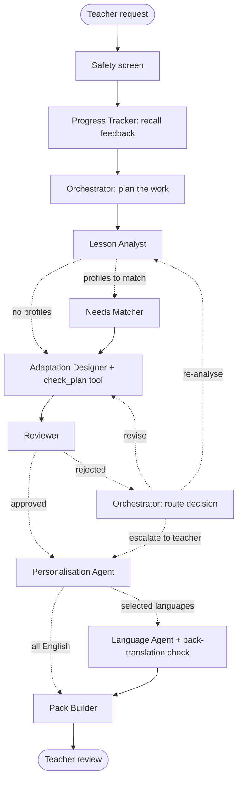

# Mothusi: your intelligent classroom colleague

*Mothusi* means "helper" in Setswana. It is a team of AI agents that works alongside **Grade 1–4 teachers** in South
Africa (CAPS). It turns learner support needs into practical classroom action. It analyses a lesson, matches it to
learner support profiles, designs adaptations that fit the teacher's real constraints, checks and corrects its own
work, writes personalised learner material and translates it into the language the teacher or learner chose.

Built for the Melsoft Academy *Colleague Zero* hackathon (13–14 November 2026).

> Teachers make every final decision. Mothusi never diagnoses learners, never uses medical or deficit labels and
> never guesses a learner's language from their name or background.

## How the agents work

Mothusi's lesson-planning workflow is a **LangGraph** state graph. The AI makes the judgement calls, and code
enforces guardrails the AI cannot talk its way past.



| Who decides | What |
| --- | --- |
| **Orchestrator (AI planner)** | Which learners need the most attention, who needs their own material, what the Designer must keep in mind, what could go wrong |
| **Adaptation Designer (AI + tools)** | Starts from a vetted strategy library filtered to the class and the day's conditions, drafts adaptations, tests them with the `check_plan` tool, fixes what the tool finds, then submits |
| **Reviewer (code + AI)** | Code checks: one-to-one time budget, preparation-time budget, printer, devices, noisy venue, coverage, diagnostic labels, repeats of strategies that failed. AI review: objective kept, linked to profile, right for the age |
| **Orchestrator (AI router)** | Where rejected work goes: back to the Designer, back to the Lesson Analyst, or escalated to the teacher |
| **Code guardrails** | Nothing skips the Reviewer; design rounds are capped; the lesson is re-analysed at most once; one revision is always tried before escalating; the AI never chooses a learner's language; diagnostic labels are removed before any agent sees a profile |

If the planner or router model fails, the graph falls back to a safe default route and says so in the timeline.

Every step is a timestamped event tagged with its graph node, streamed live to the teacher portal. The planner page
and **How Mothusi worked** show the graph with the active agent lit up and the path the run actually took, plus a full
timeline with reasoning excerpts and every routing decision. Any run can be replayed.

**Adapting when things change.** When a teacher changes a condition (for example "tomorrow is in a noisy hall") or
returns the plan with a note, Mothusi re-checks every existing adaptation, redesigns only the ones that no longer fit,
refreshes only the learner material affected, and shows what changed.

**Learning from feedback.** After teaching, the teacher rates each adaptation. The Progress Tracker stores it, and
future plans bring it in: strategies that worked are reused and strategies that did not are rejected if repeated.
The model is never retrained.

**Failing safely.** API failures are retried, malformed model output is sent back for repair, and loops are capped.
When a run cannot finish, it stops with a clear message instead of pretending to succeed.

## Run it

Backend (Python 3.10+, [uv](https://docs.astral.sh/uv/)):

```bash
cd backend
cp .env.example .env          # add NVIDIA_API_KEY; without it Mothusi uses practice mode (the offline model)
uv sync
uv run uvicorn main:app --reload --port 8000
```

Frontend (Node 20+):

```bash
cd frontend
npm install
npm run dev                   # http://localhost:5173, proxies /api to port 8000
```

### Accounts and access

Teachers create an account through the teacher setup flow (email and password). Older learners can create an account
with an email, or join with the code their teacher gives them. **Young learners sign in with pictures** at `/join`:
they type the class code, tap their name, then tap three pictures (chosen and confirmed the first time). Five wrong
tries lock picture sign-in for 10 minutes, and the teacher can reset a learner's pictures on **Learners & codes**.

Everything a teacher creates is saved to their account on the server, not in the browser: classes (with each class's
usual classroom conditions), learner profiles, lesson plans and uploaded materials (whose text Mothusi reads and plans
from). Each teacher only ever sees their own work. A new teacher starts empty, with a "Get your class ready" checklist
and an optional sample class (marked **Sample**, made-up learners).

**Password recovery:** "Forgot your password?" emails a one-hour, single-use link (set `MOTHUSI_SMTP_HOST`,
`MOTHUSI_SMTP_PORT`, `MOTHUSI_SMTP_USER`, `MOTHUSI_SMTP_PASSWORD`, `MOTHUSI_SMTP_FROM` and `MOTHUSI_PUBLIC_URL`).
Without email set up, the link is written to the backend log; `MOTHUSI_SHOW_RESET_LINKS=1` also shows it on screen
for local testing only. Changing a password logs the account out everywhere.

Terminal demo of the full workflow: `cd backend && uv run python -m scripts.demo` (add `--offline` for the offline
model).

Tests: `cd backend && uv run pytest`.

### Database (Supabase)

Locally Mothusi keeps everything in a SQLite file, so it runs with no setup. For a deployment, point it at
PostgreSQL; Supabase works out of the box:

1. Create a Supabase project and note the database password you choose.
2. In **Project Settings → Database → Connection string**, copy the **URI** for the **Session pooler**
   (it works from hosts without IPv6, which includes most free hosting).
3. Put it in `backend/.env` (or your host's environment) with your password filled in:
   `MOTHUSI_DATABASE_URL=postgresql://postgres.<ref>:<password>@aws-0-<region>.pooler.supabase.com:5432/postgres?sslmode=require`
   URL-encode any `@ : / # ?` in the password.
4. Start the backend. It creates its tables on first start and turns on row-level security for each one, so
   Supabase's public API keys cannot read them; only the backend, which connects as the database owner, can.
5. Optional: copy your local data across with `cd backend && uv run python -m scripts.copy_to_postgres`.
   It can be run more than once safely.

Mothusi uses Supabase as a PostgreSQL database only: accounts, sessions and uploaded materials are handled by the
backend itself, not by Supabase Auth or Storage. Run one backend instance: live agent progress is streamed from
the process that runs the agents. To run the tests against PostgreSQL, set `MOTHUSI_TEST_DATABASE_URL` to an empty
throwaway database (never the production one: the tests empty its tables).

### Deploying on Vercel

Mothusi deploys as **two Vercel projects from this repository**: the website (`frontend/`) and the API (`backend/`).
Both read their settings from the `vercel.json` in their folder.

How the agents run on Vercel: Vercel pauses a function as soon as it has replied, so the backend switches itself to
*request mode* (it detects Vercel). Creating a lesson saves it; the browser then calls `/execute`, and the agents run
inside that request, for up to 5 minutes on the free Hobby plan. Moving between pages inside Mothusi is fine, but
**closing the tab stops a lesson that is still being prepared**; it is then marked "Not finished" and can be tried
again. Live progress is read from the database, so it works whichever server instance answers. On Vercel, uploads are
limited to 3 MB (Vercel accepts at most 4.5 MB per request).

Before the first deploy, stop tracking the installed packages and build output (they are in `.gitignore` now):
`git rm -r --cached frontend/node_modules frontend/dist`, then commit and push.

1. **Backend project.** In Vercel: Add New → Project → import the repository → Root Directory `backend`.
   Environment variables:
   - `NVIDIA_API_KEY`: your key
   - `MOTHUSI_DATABASE_URL`: the Supabase **Transaction pooler** URI (port `6543`, built for serverless), with your
     database password: `postgresql://postgres.<ref>:<password>@aws-1-eu-west-2.pooler.supabase.com:6543/postgres?sslmode=require`
   - `MOTHUSI_CORS_ORIGINS`: the website's address, for example `https://mothusi.vercel.app`
   - `MOTHUSI_PUBLIC_URL`: the same address (used in password-reset emails)
   - optional: `MOTHUSI_LLM_TIMEOUT=90` so a slow model call cannot use up the 5 minutes; the `MOTHUSI_SMTP_*`
     settings for reset emails
2. **Frontend project.** Import the same repository again → Root Directory `frontend`. Environment variable:
   `VITE_API_URL` = the backend's address, for example `https://mothusi-api.vercel.app` (no trailing slash).
3. Deploy both. If you set the website address after the backend's first deploy, redeploy the backend so it picks up
   `MOTHUSI_CORS_ORIGINS`.

The API functions run in London (`lhr1`), next to the Supabase database. Schema changes go in `supabase/migrations/`
and are applied with `supabase db push`; the backend also adds any missing tables and columns when it starts.

### Models

| Setting | Default | Used for |
| --- | --- | --- |
| `MOTHUSI_LLM_MODEL` | `nvidia/nemotron-3-nano-omni-30b-a3b-reasoning` | Planning agents (fast) |
| `MOTHUSI_LANGUAGE_MODEL` | `nvidia/nemotron-3-ultra-550b-a55b` | Translation and back-translation |
| `MOTHUSI_REASONING_TASKS` | `lesson_analyst,adaptation_designer,reviewer` | Tasks where the planning model reasons first |

Built with LangGraph (workflow graph), Pydantic (validated agent outputs), the `openai` client (NVIDIA's
OpenAI-compatible API), FastAPI with Server-Sent Events (live streaming), SQLite (runs, events, feedback) and React.

**Practice mode** (the offline model) is rule-based and clearly labelled in the UI. Tick "Practice mode" in the
planner to rehearse, or to use it as a fallback if the network fails during judging. It cannot translate, and it says
so. Teachers never see model names; the "How Mothusi worked" view shows "Live AI agents" or "Practice mode".

## Demo script (about 5 minutes)

1. **Home → Try with a sample class.** Grade 4A (Sample) with three made-up learners: Learner A (visual), Learner B
   (short structured steps), Learner C (practical, learns in Setswana).
2. **New lesson.** Pick a CAPS topic (it fills the topic, objective and key words). The class's usual conditions are
   shown in one line; "Anything different tomorrow?" changes them. **Prepare lesson.**
3. **The wait.** The short progress view shows each step and what it found, with a time estimate. The lesson is
   saved as *Preparing…* and finishes even if you leave. "Show how the agents worked" opens the live graph and the
   full timeline: the Reviewer rejecting a draft, the router sending back only that item, the Designer's fix.
4. **Review.** The summary card (learners supported, your minutes against your budget, checks passed), the sticky
   Approve / Edit / Return bar, and detail sections that open on demand. Try **Conditions changed → noisy venue**:
   only the adaptations that no longer fit are redesigned. **Approve.**
5. **Learners & codes → Show on screen.** On a phone, open `/join`, type the code, tap *Learner B*, choose three
   pictures. Open the lesson, use "Read it to me", ask for "Show me with pictures", do the practice and the reflection.
6. **Back to the teacher.** The lesson now shows "1 of 40 opened", the most-missed question and how it felt; Class
   insights shows each learner. Open the **Lesson card** for teach mode (phase timer, who needs what now) and
   **Share as image**.
7. **Plan again.** The Progress Tracker recalls the learner's practice as evidence (and your feedback, if given), and
   the next plan builds on it.

## Repository layout

```
backend/
  main.py                 FastAPI app entry (uvicorn main:app)
  config.py               settings from .env
  agents/                 one module per agent
  orchestration/          LangGraph lesson workflow (graph.py), re-planning and shared steps (workflow.py),
                          run manager, event trace
  tools/                  deterministic checks, safety screening, pack rendering
  models/                 Pydantic schemas and the Grades 1–4 curriculum scope
  llm/                    NVIDIA client and the offline demo model
  storage/                SQLite store for runs, events and feedback
  api/                    HTTP routes and the live event stream (Server-Sent Events)
  scripts/demo.py         terminal demo
  tests/                  pytest suite
frontend/src/
  teacher/  learner/  components/  hooks/  services/  pages/  styles/
```

## Responsible AI

- Synthetic learner profiles only. Agents see a learner label, strengths, support notes and the selected language.
- Diagnostic labels are removed before any agent sees a profile; outputs are checked for them too.
- Translations are always marked as AI drafts for a fluent speaker to check; learners only see translations that
  passed the back-translation check.
- Teacher approval is required before material reaches learners.
